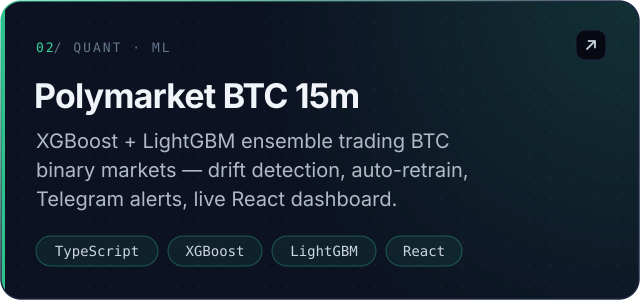
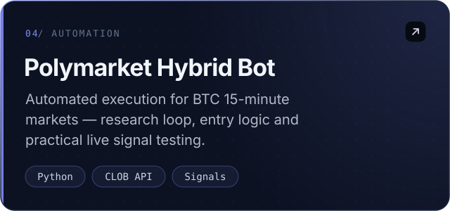
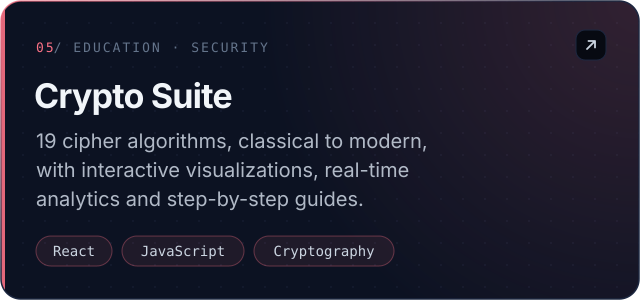
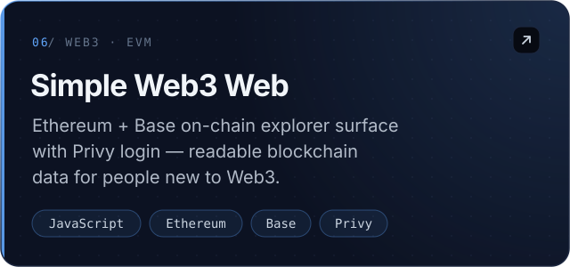
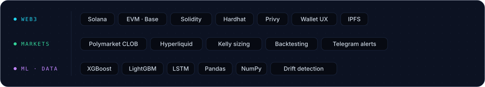

  
  
  
  

 

I'm **Timotius Kusuma Wardana Putra**, a Web3 developer from Indonesia who came up through the market side of crypto — four years as **trader → airdrop hunter → alpha hunter → builder**. That path shapes how I build: wallet-native products that feel simple for normal people, and trading systems that have to survive contact with live markets.

- **Building** — [DollarKilat](https://dollarkilat.xyz): get paid in USDC, spend through QRIS, on Solana
- **Researching** — BTC price forecasting, XGBoost vs LSTM on technical + on-chain features
- **Exploring** — Hyperliquid perps, game theory in prediction markets, Web3 payment rails
- **Ask me about** — dApps · DeFi · prediction markets · quant automation

 

  
  
  
  
  
  

  
    Live → <a href="https://dollarkilat.xyz">dollarkilat.xyz</a> ·
    <a href="https://jurnalisme-damai.vercel.app">jurnalisme-damai.vercel.app</a> ·
    <a href="https://github.com/masterputra169?tab=repositories">all repositories ↗</a>
  

 

  

  

  
  

<picture>
  <source media="(prefers-color-scheme: dark)" srcset="https://raw.githubusercontent.com/masterputra169/masterputra169/output/github-contribution-grid-snake-dark.svg" />
  <source media="(prefers-color-scheme: light)" srcset="https://raw.githubusercontent.com/masterputra169/masterputra169/output/github-contribution-grid-snake.svg" />
  
</picture>

  

  
  
  
  

