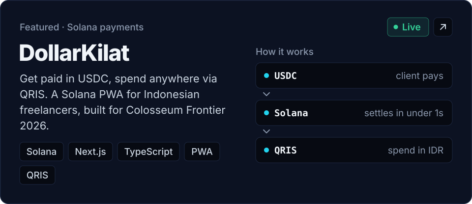
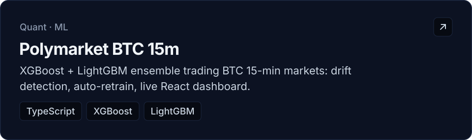
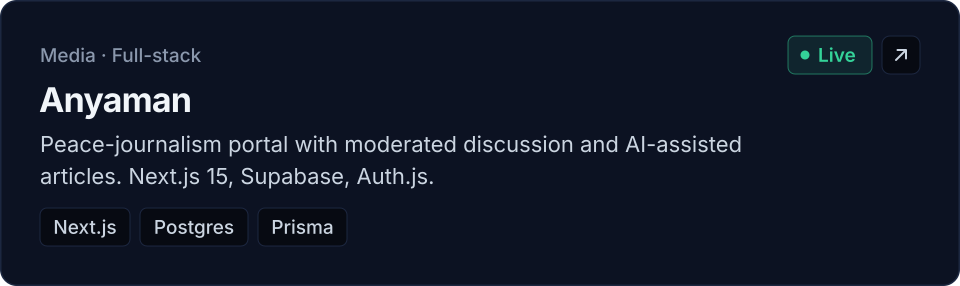
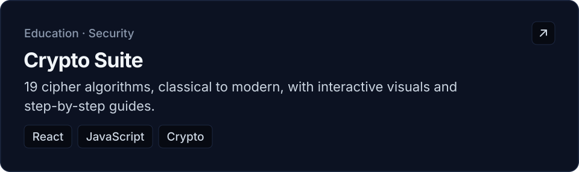
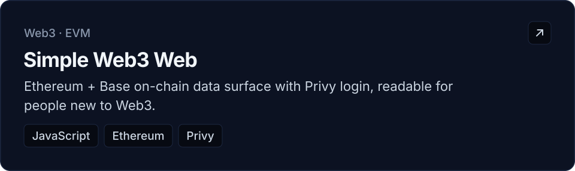
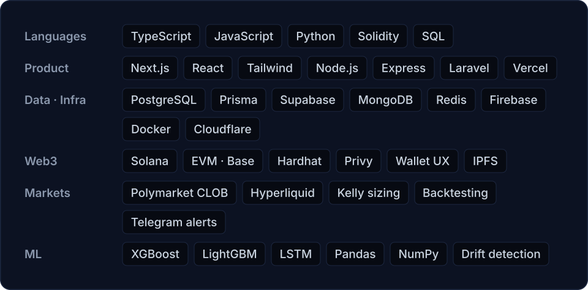

<a href="https://github.com/masterputra169"><picture>
  <source media="(max-width: 1011px) and (prefers-color-scheme: dark)" srcset="https://raw.githubusercontent.com/masterputra169/masterputra169/output/header-dark-narrow.svg" />
  <source media="(max-width: 1011px) and (prefers-color-scheme: light)" srcset="https://raw.githubusercontent.com/masterputra169/masterputra169/output/header-light-narrow.svg" />
  <source media="(max-width: 1011px)" srcset="https://raw.githubusercontent.com/masterputra169/masterputra169/output/header-dark-narrow.svg" />
  <source media="(prefers-color-scheme: dark)" srcset="https://raw.githubusercontent.com/masterputra169/masterputra169/output/header-dark.svg" />
  <source media="(prefers-color-scheme: light)" srcset="https://raw.githubusercontent.com/masterputra169/masterputra169/output/header-light.svg" />
  
</picture></a>

  
  
  

## About

I'm **Timotius Kusuma Wardana Putra**, a Web3 developer from Indonesia who came up through the market side of crypto, with four years as **trader → airdrop hunter → alpha hunter → builder**. That path shapes how I build: wallet-native products that feel simple for normal people, and trading systems that have to survive contact with live markets.

- **Building:** [DollarKilat](https://dollarkilat.xyz), get paid in USDC and spend through QRIS, on Solana
- **Researching:** BTC price forecasting, XGBoost vs LSTM on technical + on-chain features
- **Exploring:** Hyperliquid perps, game theory in prediction markets, Web3 payment rails
- **Ask me about:** dApps · DeFi · prediction markets · quant automation

## Selected work

<a href="https://github.com/masterputra169/dollarkilat"><picture>
  <source media="(max-width: 1011px) and (prefers-color-scheme: dark)" srcset="https://raw.githubusercontent.com/masterputra169/masterputra169/output/card-dollarkilat-dark-narrow.svg" />
  <source media="(max-width: 1011px) and (prefers-color-scheme: light)" srcset="https://raw.githubusercontent.com/masterputra169/masterputra169/output/card-dollarkilat-light-narrow.svg" />
  <source media="(max-width: 1011px)" srcset="https://raw.githubusercontent.com/masterputra169/masterputra169/output/card-dollarkilat-dark-narrow.svg" />
  <source media="(prefers-color-scheme: dark)" srcset="https://raw.githubusercontent.com/masterputra169/masterputra169/output/card-dollarkilat-dark.svg" />
  <source media="(prefers-color-scheme: light)" srcset="https://raw.githubusercontent.com/masterputra169/masterputra169/output/card-dollarkilat-light.svg" />
  
</picture></a>

<a href="https://github.com/masterputra169/polymarket-btc-15-minutes"><picture>
  <source media="(max-width: 1011px) and (prefers-color-scheme: dark)" srcset="https://raw.githubusercontent.com/masterputra169/masterputra169/output/card-polymarket-btc-dark-narrow.svg" />
  <source media="(max-width: 1011px) and (prefers-color-scheme: light)" srcset="https://raw.githubusercontent.com/masterputra169/masterputra169/output/card-polymarket-btc-light-narrow.svg" />
  <source media="(max-width: 1011px)" srcset="https://raw.githubusercontent.com/masterputra169/masterputra169/output/card-polymarket-btc-dark-narrow.svg" />
  <source media="(prefers-color-scheme: dark)" srcset="https://raw.githubusercontent.com/masterputra169/masterputra169/output/card-polymarket-btc-dark.svg" />
  <source media="(prefers-color-scheme: light)" srcset="https://raw.githubusercontent.com/masterputra169/masterputra169/output/card-polymarket-btc-light.svg" />
  
</picture></a>

<a href="https://github.com/masterputra169/jurnalisme-damai"><picture>
  <source media="(max-width: 1011px) and (prefers-color-scheme: dark)" srcset="https://raw.githubusercontent.com/masterputra169/masterputra169/output/card-anyaman-dark-narrow.svg" />
  <source media="(max-width: 1011px) and (prefers-color-scheme: light)" srcset="https://raw.githubusercontent.com/masterputra169/masterputra169/output/card-anyaman-light-narrow.svg" />
  <source media="(max-width: 1011px)" srcset="https://raw.githubusercontent.com/masterputra169/masterputra169/output/card-anyaman-dark-narrow.svg" />
  <source media="(prefers-color-scheme: dark)" srcset="https://raw.githubusercontent.com/masterputra169/masterputra169/output/card-anyaman-dark.svg" />
  <source media="(prefers-color-scheme: light)" srcset="https://raw.githubusercontent.com/masterputra169/masterputra169/output/card-anyaman-light.svg" />
  
</picture></a>

<a href="https://github.com/masterputra169/crypto-suite"><picture>
  <source media="(max-width: 1011px) and (prefers-color-scheme: dark)" srcset="https://raw.githubusercontent.com/masterputra169/masterputra169/output/card-crypto-suite-dark-narrow.svg" />
  <source media="(max-width: 1011px) and (prefers-color-scheme: light)" srcset="https://raw.githubusercontent.com/masterputra169/masterputra169/output/card-crypto-suite-light-narrow.svg" />
  <source media="(max-width: 1011px)" srcset="https://raw.githubusercontent.com/masterputra169/masterputra169/output/card-crypto-suite-dark-narrow.svg" />
  <source media="(prefers-color-scheme: dark)" srcset="https://raw.githubusercontent.com/masterputra169/masterputra169/output/card-crypto-suite-dark.svg" />
  <source media="(prefers-color-scheme: light)" srcset="https://raw.githubusercontent.com/masterputra169/masterputra169/output/card-crypto-suite-light.svg" />
  
</picture></a>

<a href="https://github.com/masterputra169/simple-web3-web"><picture>
  <source media="(max-width: 1011px) and (prefers-color-scheme: dark)" srcset="https://raw.githubusercontent.com/masterputra169/masterputra169/output/card-simple-web3-dark-narrow.svg" />
  <source media="(max-width: 1011px) and (prefers-color-scheme: light)" srcset="https://raw.githubusercontent.com/masterputra169/masterputra169/output/card-simple-web3-light-narrow.svg" />
  <source media="(max-width: 1011px)" srcset="https://raw.githubusercontent.com/masterputra169/masterputra169/output/card-simple-web3-dark-narrow.svg" />
  <source media="(prefers-color-scheme: dark)" srcset="https://raw.githubusercontent.com/masterputra169/masterputra169/output/card-simple-web3-dark.svg" />
  <source media="(prefers-color-scheme: light)" srcset="https://raw.githubusercontent.com/masterputra169/masterputra169/output/card-simple-web3-light.svg" />
  
</picture></a>

## Stack

<picture>
  <source media="(max-width: 1011px) and (prefers-color-scheme: dark)" srcset="https://raw.githubusercontent.com/masterputra169/masterputra169/output/stack-dark-narrow.svg" />
  <source media="(max-width: 1011px) and (prefers-color-scheme: light)" srcset="https://raw.githubusercontent.com/masterputra169/masterputra169/output/stack-light-narrow.svg" />
  <source media="(max-width: 1011px)" srcset="https://raw.githubusercontent.com/masterputra169/masterputra169/output/stack-dark-narrow.svg" />
  <source media="(prefers-color-scheme: dark)" srcset="https://raw.githubusercontent.com/masterputra169/masterputra169/output/stack-dark.svg" />
  <source media="(prefers-color-scheme: light)" srcset="https://raw.githubusercontent.com/masterputra169/masterputra169/output/stack-light.svg" />
  
</picture>

## Activity

<picture>
  <source media="(max-width: 1011px) and (prefers-color-scheme: dark)" srcset="https://raw.githubusercontent.com/masterputra169/masterputra169/output/stats-dark-narrow.svg" />
  <source media="(max-width: 1011px) and (prefers-color-scheme: light)" srcset="https://raw.githubusercontent.com/masterputra169/masterputra169/output/stats-light-narrow.svg" />
  <source media="(max-width: 1011px)" srcset="https://raw.githubusercontent.com/masterputra169/masterputra169/output/stats-dark-narrow.svg" />
  <source media="(prefers-color-scheme: dark)" srcset="https://raw.githubusercontent.com/masterputra169/masterputra169/output/stats-dark.svg" />
  <source media="(prefers-color-scheme: light)" srcset="https://raw.githubusercontent.com/masterputra169/masterputra169/output/stats-light.svg" />
  
</picture>

<picture>
  <source media="(prefers-color-scheme: dark)" srcset="https://raw.githubusercontent.com/masterputra169/masterputra169/output/github-contribution-grid-snake-dark.svg" />
  <source media="(prefers-color-scheme: light)" srcset="https://raw.githubusercontent.com/masterputra169/masterputra169/output/github-contribution-grid-snake.svg" />
  
</picture>

## Connect

  <a href="https://x.com/masterputra6969"><picture><source media="(prefers-color-scheme: dark)" srcset="https://raw.githubusercontent.com/masterputra169/masterputra169/output/connect-x-dark.svg" /><source media="(prefers-color-scheme: light)" srcset="https://raw.githubusercontent.com/masterputra169/masterputra169/output/connect-x-light.svg" /></picture></a>&nbsp;&nbsp;
  <a href="https://www.linkedin.com/in/timotius-kusuma-wardana-putra/"><picture><source media="(prefers-color-scheme: dark)" srcset="https://raw.githubusercontent.com/masterputra169/masterputra169/output/connect-linkedin-dark.svg" /><source media="(prefers-color-scheme: light)" srcset="https://raw.githubusercontent.com/masterputra169/masterputra169/output/connect-linkedin-light.svg" /></picture></a>&nbsp;&nbsp;
  <a href="https://github.com/masterputra169"><picture><source media="(prefers-color-scheme: dark)" srcset="https://raw.githubusercontent.com/masterputra169/masterputra169/output/connect-github-dark.svg" /><source media="(prefers-color-scheme: light)" srcset="https://raw.githubusercontent.com/masterputra169/masterputra169/output/connect-github-light.svg" /></picture></a>&nbsp;&nbsp;
  <a href="https://dollarkilat.xyz"><picture><source media="(prefers-color-scheme: dark)" srcset="https://raw.githubusercontent.com/masterputra169/masterputra169/output/connect-dollarkilat-dark.svg" /><source media="(prefers-color-scheme: light)" srcset="https://raw.githubusercontent.com/masterputra169/masterputra169/output/connect-dollarkilat-light.svg" /></picture></a>

 

<picture>
  <source media="(max-width: 1011px) and (prefers-color-scheme: dark)" srcset="https://raw.githubusercontent.com/masterputra169/masterputra169/output/footer-dark-narrow.svg" />
  <source media="(max-width: 1011px) and (prefers-color-scheme: light)" srcset="https://raw.githubusercontent.com/masterputra169/masterputra169/output/footer-light-narrow.svg" />
  <source media="(max-width: 1011px)" srcset="https://raw.githubusercontent.com/masterputra169/masterputra169/output/footer-dark-narrow.svg" />
  <source media="(prefers-color-scheme: dark)" srcset="https://raw.githubusercontent.com/masterputra169/masterputra169/output/footer-dark.svg" />
  <source media="(prefers-color-scheme: light)" srcset="https://raw.githubusercontent.com/masterputra169/masterputra169/output/footer-light.svg" />
  
</picture>
